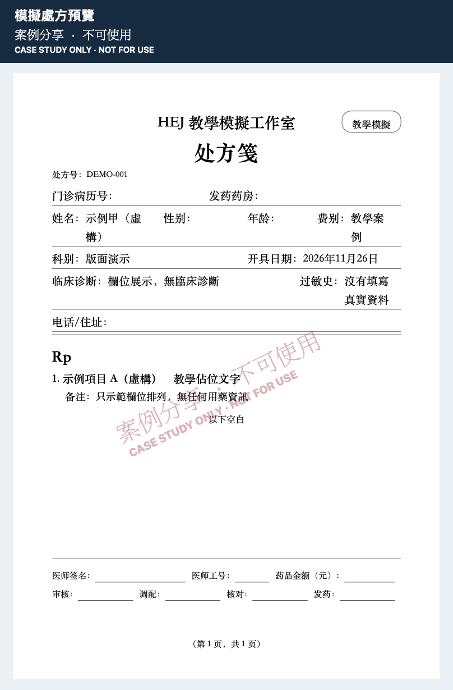
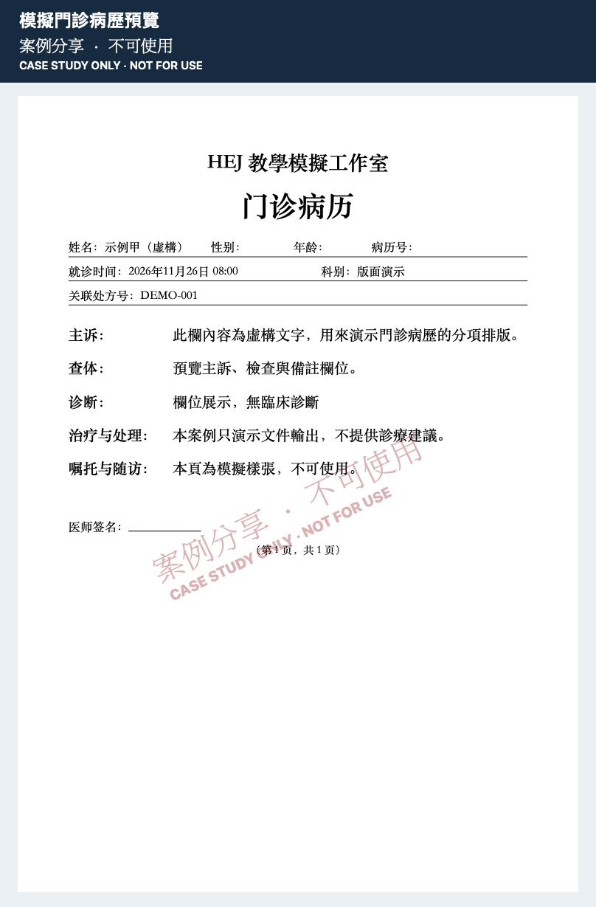

> [!CAUTION]
> **僅供教學模擬及案例分享。所有示例文件均不可使用。**
>
> 本專案只供程式設計練習、流程演示及排版測試。透過本軟體建立、預覽、列印或匯出的內容均不具處方、病歷或醫療證明效力。請只使用虛構資料，亦請勿輸入或分享真實的姓名、病歷、身分證明資料、醫師簽名或機構印章。
>
> **嚴禁任何人藉此偽造或變造醫療文件、冒用醫療機構或醫師身分、購買或領取真實藥品，或用於診療、報銷、理賠、請假、詐騙及其他違法活動。** 嚴禁將樣張冒充真實文件。疑似違規使用可向相關平台或主管機關通報。
>
> **For educational simulation and case studies only. Not for use.** Do not use any output for clinical care, to obtain medication, to impersonate a medical professional, or as evidence in any real-world transaction.

<h1 align="center">🍥 Hej’s Prescription Maker</h1>

<strong>HEJ 處方與病歷模擬工作台</strong>

## 我為什麼做這個

本專案致力於提供處方模擬與格式參考服務，供學習、流程演示及版面測試使用。你可以在 Mac 上使用虛構資料，練習填寫處方與門診病歷欄位並預覽版面。這裡是同一專案的公開發布頁面。

## 主要功能

| 功能 | 可以做什麼 |
| --- | --- |
| **模擬處方編輯** | 填寫虛構基本資料和處方欄位，選用常用模板，一邊編輯一邊預覽。 |
| **模擬門診病歷編輯** | 選用敘述式或分項式版面，整理主訴、檢查和備註等示例欄位。 |
| **歷史紀錄及模板** | 查找已儲存的模擬紀錄、複製為新的範例，並儲存常用欄位組合。 |
| **版面預覽與輸出** | 預覽 A5 或 A4 文件，匯出 PDF 或列印，用於演示及排版測試。 |

模擬紀錄與模板存放在自己的 Mac 上，工作台可離線使用。

## 案例分享

處方和門診病歷樣張均使用虛構資料。

### 模擬處方

### 模擬門診病歷

## 下載

[macOS v1.0](https://github.com/Hej28/Hejs-Prescription-Maker/releases/tag/v1.0) 適用於搭載 Apple 晶片、執行 macOS 14 或更新版本的 Mac。從 Release 的 **Assets** 下載 ZIP 並解壓縮，即可取得 `Hej's Prescription Maker.app`。此版本採用臨時簽名，未經 Apple 公證，macOS 可能會阻擋開啟。

## 開發紀錄

下列 0.1.x 版本是作者在本地迭代的紀錄，這些舊版未上傳至本公開倉庫。

| 版本 | 這版做了什麼 |
| --- | --- |
| **v1.0** | macOS 首個公開版本，提供處方與門診病歷模擬、歷史紀錄和文件預覽。 |
| 0.1.21 | 應用程式名稱改為 Hej's Prescription Maker，Finder 和 Dock 加入 🍥 圖示。 |
| 0.1.20 | 加入常用症狀和中藥用法詞庫，選詞可以加到病歷主訴和煎服要求。 |
| 0.1.19 | 加入 A4 門診日誌預覽、PDF 匯出和列印。工作量報表顯示處方合計。 |
| 0.1.18 | 加入處方和病歷的歷史匯入。寫入前檢查重複和缺漏，保留編號、日期與正文。 |
| 0.1.17 | 可按藥名筆畫搜尋，短藥名也能補輸末字筆畫。加入 Access 歷史資料預檢和唯讀匯出。 |
| 0.1.16 | 加入進貨和銷售統計，支援按類別篩選與匯出 Excel。 |
| 0.1.15 | 新處方可帶入預設費別，每張仍可單獨修改。 |
| 0.1.14 | 加入啟動密碼、手動鎖定和解鎖後繼續編輯。 |
| 0.1.13 | 藥品目錄支援 `.xls` 和 `.xlsx` 匯入匯出，匯入前可檢查新增和重複資料。 |
| 0.1.12 | 出庫明細可按斗位排序，儲存後可列印 58 或 80 mm 取藥小票。 |
| 0.1.11 | 加入 24 個套印欄位的位置預設。撤銷發藥時，數量會退回原批次。 |
| 0.1.10 | 處方、病歷和取藥單可各選印表機，病歷與輸液卡可分別調整邊距。 |
| 0.1.9 | 門診病歷可引用歷史處方，同次就診可另開一張新編號的處方。 |
| 0.1.8 | 加入取藥單、輸液注射卡和藥品標籤的預覽、匯出及列印。 |
| 0.1.7 | 加入收費登記與作廢，工作量、用藥和門診日誌可匯出 Excel。 |
| 0.1.6 | 加入自動劃價、批次入庫、出庫、報損和低庫存篩選。 |
| 0.1.5 | 加入藥品目錄及詞庫匯入，患者檔案可在處方和病歷共用。 |
| 0.1.4 | 擴充到五種紙本版式，加入敘述式與分項式門診病歷，改善 A4 排版。 |
| 0.1.3 | 在工作台提供可直接套用的紙本版式和 16 個內容模板，側邊欄加入 HEJ 著作權標示。 |
| 0.1.2 | 加入醫師簽名，可手寫、匯入圖片、調整紙上大小及匯出 PNG。 |
| 0.1.1 | 加入簡體、繁體及英文切換，可自訂機構名稱、處方類型和條碼位置。 |
| 0.1.0 | 完成 Mac 工作台的基本流程，可錄入、儲存、查歷史、套用模板和預覽紙本。 |

## 未來想做的事

- **Windows 版本。** 將主要模擬編輯及版面預覽功能帶到 Windows。
- **更多自訂功能。** 擴充模擬模板、欄位和紙張版面的自訂選項。
- **聯網演示。** 探索在同一個區域網路分享虛構資料，演示工作站之間的流程。單機仍可離線使用。
- **排版校準。** 使用空白教學樣紙測試欄位對齊與分頁。

## 歡迎回饋

如果你對模擬流程、欄位設計或輸出版面有建議，歡迎在 [GitHub Issues](https://github.com/Hej28/Hejs-Prescription-Maker/issues) 告訴我。請以虛構資料舉例。如果你想支持我繼續開發，也歡迎 **Donate**。

## 個人著作權聲明

**© 2026 Hej。保留所有權利。**

本專案的原創程式碼、介面設計、文件及演示素材由作者 Hej 保留相關權利。第三方素材的權利歸各自權利人。本倉庫公開提供說明、演示圖與 App 發布附件。下載許可限於上述教學、測試與演示用途，重新散布、修改後發布或商業使用須經作者事先書面許可，法律另有規定者除外。

HEJ · SwiftUI / SQLite

